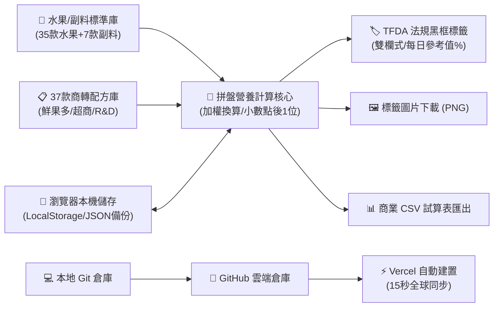

# 🍊 Cfruit 水果營養計算機 & 商品法規標籤系統 — 專案完整歷程與成果總覽 (Project Summary)

> **版本**：v2.0 Production Release  
> **線上正式網址**：[https://cfruit-calculator.vercel.app](https://cfruit-calculator.vercel.app)  
> **GitHub 倉庫**：[https://github.com/sogdlanit/cfruit-calculator](https://github.com/sogdlanit/cfruit-calculator)  
> **法規遵循標準**：衛生福利部食品藥物管理署 (TFDA)《包裝食品營養標示應遵行事項》與 CNS 2925 標準

---

## 📌 一、 專案核心定位與架構

本系統專為**生鮮蔬果切盤、果昔調飲、連鎖手搖飲、輕食沙拉盒與包裝食品業者**設計，結合「**高精度營養換算**」、「**法規黑框標籤一鍵生成**」與「**商業配方資料庫管理**」，全站採純前端零相依（Zero-dependency）現代化架構，所有運算皆在用戶瀏覽器端秒速完成，**零 Token 消耗、零伺服器維護成本**。



---

## 🏛️ 二、 核心資料庫 TFDA 衛福部全數校正與法規對齊

系統全數 35 款核心水果及各項副料，皆透過自動化爬蟲與衛福部食藥署（TFDA）「臺灣食品營養成分資料庫」官方檢驗樣品進行 **14 大營養素逐筆精確校核**，徹底解決歷史資料混淆與誤植問題：

### 1. 重大樣品品種與數據修正對照

| 原料品項 | TFDA 樣品對照 | 樣品 ID | 關鍵校正重點 |
| :--- | :--- | :---: | :--- |
| **富士蘋果(帶皮)** | 富士蘋果(帶皮) | `2040` | 採用帶皮去核樣品（D3200501），膳食纖維修正為 **1.7g**、維生素 C **4.9mg**，忠實呈現連皮營養。 |
| **香蕉** | 北蕉平均值 | `24` | **重大修正！** 修正原 CSV 欄位倒置（將鉀 368mg 誤填為鈉），鈉修正為 **0.0mg**，糖修正為 **18.0g**。 |
| **愛文芒果** | 愛文芒果 | `238` | **重大修正！** 修正原 CSV 蛋白質 4.0g 灌水筆誤，回歸真實值 **0.4g**，熱量修正為 **42.0 kcal**。 |
| **奇異果** | 奇異果 | `411` | **重大修正！** 修正原 CSV 碳水 34.0g、糖 1.0g 嚴重失真，校正為 **碳水 14.0g、糖 9.3g、熱量 56.0 kcal**。 |
| **百香果** | 百香果(台農一號) | `261` | 區分過濾果汁與帶籽全果：生果採台農一號實測（熱量 **102.0 kcal**、糖 **11.5g**、纖維 **4.9g**）。另保留純百香果汁（ID 687）。 |
| **酪梨** | 酪梨(綠皮) | `368` | 修正原 CSV 誤採麻豆早生高脂種，全面對齊市售主流綠皮酪梨（熱量 **65.0 kcal**、脂肪 **3.7g**、纖維 **3.4g**）。 |
| **珍珠芭樂** | 珍珠芭樂 | `299` | 熱量校正為 **42.0 kcal**，維生素 C 高達 **193.7mg**、纖維 **3.7g**。 |
| **紅心芭樂** | 紅心芭樂 | `2034` | 維生素 C 達全庫之冠 **214.4mg**，天然茄紅素抗氧化首選。 |
| **菠菜 / 芹菜** | 菠菜 / 西洋芹菜 | `529` / `551` | 補齊原資料庫缺失之纖維與維生素 C，波菜鈉 **54.0mg**、芹菜鈉 **61.0mg**。 |
| **蔓越莓** | 蔓越莓全果 | `USDA` | TFND 目前僅收錄非原汁果汁，生果依業界國際規範透明採用 USDA 標準檢驗數據。 |
| **義美布丁** | 雞蛋布丁 | `官方包裝` | 修正為原廠外盒實測值：熱量 **137.0 kcal**、蛋白質 **2.5g**、脂肪 **3.6g**、糖 **20.9g**。 |

### 2. 小數點後一位法規遵循規範
* 全數數值遵循衛福部《包裝食品營養標示應遵行事項》與 CNS 2925 修約標準。
* 無論是熱量、三大營養素、反式脂肪（如 `0.0g`）或微量元素，**全面格式化為小數點後一位**（如 `42.0`、`1.5`、`0.0`），消除法規稽查風險。

---

## 📑 三、 37 款商業配方庫與三區分流體系

系統完整內建業務與產線已落地的 37 款商轉配方，並依通路與研發狀態進行三區劃分，支援彈窗快速預覽、一鍵載入計算與搜尋篩選：

### 1. 鮮果多區（門市鮮切 / 招牌調飲共 19 款）
* **代表品項**：香芒 (190g)、野莓 (161g)、翡翠 (180g)、綠果昔 (185g)、火龍果 (175g)、紅果昔 (171g)、鳳梨芭樂 (120g)、芒果綜合 (125g)、芒果鳳梨 (120g)、純酪梨 (110g)、酪梨香蕉 (120g)、酪梨布丁 (160g)、木瓜 (140g)、香蕉 (130g)、草莓檸檬 (127g)、大愛文芒果 (160g)、蔓越莓鳳梨 (100g)、藍莓香蕉 (40g)、番茄綜合 (180g)。

### 2. 超商區（鮮食連鎖 / 規格化鮮果包共 15 款）
* **代表品項**：超木瓜 (140g)、超鳳梨蘋果 (180g)、超番石榴特調 (180g)、超奇異果綜合 (185g)、超莓果綜合 (165g)、超酪梨 (90g)、超酪梨香蕉 (120g)、超火龍果綜合 (180g)、超芒粽 (185g)、超甜菜跟綜合 (173g)、超純鳳梨 (220g)、超百香特調 (120g)、超鳳芭 (170g)、超草莓特調 (150g)、超草莓綜合 (165g)。

### 3. R&D 研發中（試產與大包裝共 3 款）
* **代表品項**：野莓綜合(R&D) (160g)、百香鳳梨(R&D) (120g)、藍莓1Kg大包裝 (1000g)。

---

## 📊 四、 商業 CSV 試算表全面更新與重算

針對您提供的 **221 行、30 欄核心商業 CSV 檔案**，已完成全表高精度修訂並生成新檔案：

1. **上半部（第 1~11 行）**：27 項原料（含水果、蔬菜、布丁、糖液、梅粉）之 100g 基礎數值全數更新為最新 TFDA 合規值，格式統一至小數點後一位。
2. **下半部（第 12~221 行）**：14 款已上市產品之「每份」與「每100公克」營養標籤，依各配方精確投料公克數全數重新加權精算。
   * **香芒綜合**：每份蛋白質由 3.9g 修正為真實的 **1.2g**。
   * **香蕉**：每份鈉由 460.0mg 修正為合規的 **0.0mg**，淨重修正為 **125g ± 5**。
   * **綠果昔**：每份蛋白質由 3.7g 修正為 **1.8g**，鈉由 48.0mg 修正為 **27.2mg**。
   * **酪梨**：每份熱量由 91.3 kcal 修正為 **71.5 kcal**，脂肪由 8.4g 修正為 **4.1g**。
   * **酪梨布丁**：每份蛋白質 4.2g 修正為 **3.1g**，脂肪 10.8g 修正為 **6.1g**。
3. **編碼規格**：加入 UTF-8 BOM 檔頭，確保 Windows/Mac Excel、Numbers、Google Sheets 開啟永不亂碼。
4. **檔案路徑**：
   * 專案根目錄：[`nutrition_database_tfda_aligned.csv`](file:///Users/noko/Documents/antigravity/delightful-goodall/nutrition_database_tfda_aligned.csv)
   * 資產備份：[`assets/nutrition_database_tfda_aligned.csv`](file:///Users/noko/Documents/antigravity/delightful-goodall/assets/nutrition_database_tfda_aligned.csv)

---

## 💡 五、 新研發配方與 B2B 通路命名策略

針對最新研發的 2 款產品，結合業務部門現有命名規律（雙果亮點在前、三果綜合在後、特調質感），提出針對 **手搖飲店、平價餐廳、咖啡店** 的提案策略：

### 產品 A：藍莓 30g + 芭樂 140g（總重 170g）
* **特點**：高維生素 C 芭樂為底，藍莓打碎呈現**夢幻薰衣草粉紫色**，超級抗氧化花青素。
* **B2B 出貨料包名**：**`藍莓芭樂`**（或 **`紫莓芭樂`**，吧台工讀生秒懂、零出錯率）
* **通路菜單吸客名**：
  * 手搖飲店：**`藍莓鮮芭樂`**、**`紫莓芭樂冰茶`**
  * 咖啡店 / 輕食：**`紫霧芭樂果昔`**、**`藍莓纖果昔`**
  * 平價餐廳：**`藍莓芭樂汁`**

### 產品 B：鳳梨 60g + 蘋果 40g + 芭樂 80g（總重 180g）
* **特點**：芭樂甘甜 + 鳳梨酸甜 + 蘋果圓潤，台灣果汁界的**國民黃金鐵三角**，解油膩天花板。
* **B2B 出貨料包名**：**`鳳蘋芭樂`**（餐飲業辨識度最高四字）或 **`芭樂綜合`**（延續綜合體系）
* **通路菜單吸客名**：
  * 手搖飲店：**`鳳蘋鮮芭樂`**、**`鳳蘋芭樂青茶`**（常銷果茶骨幹）
  * 平價餐廳：**`金蘋芭樂汁`**、**`招牌鳳蘋芭樂`**（火鍋/牛排佐餐必備）
  * 咖啡店：**`黃金三果原汁`**、**`日光鳳蘋芭昔`**

---

## 🚀 六、 雲端公開發布與全自動持續部署 (CI/CD)

專案已正式完成全球雲端發布，達成「**跨電腦免安裝使用**」與「**代碼更新自動上線**」：

1. **雲端架構**：
   * **GitHub 倉庫**：[`sogdlanit/cfruit-calculator`](https://github.com/sogdlanit/cfruit-calculator)（主分支：`main`）
   * **託管平台**：Vercel（Hobby 個人永久免費方案，每月 100 GB 流量，約可承受 14 萬次以上開啟）
   * **正式網址**：**[https://cfruit-calculator.vercel.app](https://cfruit-calculator.vercel.app)**
2. **全自動更新機制 (CI/CD)**：
   * 當您在對話中提出新增水果、修改配方或微調界面時，代碼在本地修改並測試通過後直接 Push。
   * Vercel 會在 **15~30 秒內自動抓取最新版重新部署**。
   * 全球任何人只需按重新整理（F5 / Cmd+R）即可看到最新功能，**專屬網址永不改變**。
3. **細節優化**：
   * 彈出視窗按鈕依最新指示正式更名為 **`🏛️ FDA營養成分資料庫 ↗`**，直連食藥署官方資料頁。
4. **費用與安全**：
   * **Token 消耗**：計算機為純前端 JavaScript 本地運算，線上運作 **Token 消耗恆為 0**。
   * **伺服器費用**：Vercel Hobby 方案無信用卡綁定，**費用恆為 0**。

---

## 🛠️ 七、 本地開發與備份指引

* **本地快速啟動**：
  * 方法一：Finder 雙擊 `delightful-goodall/index.html`。
  * 方法二：終端機執行 `python3 server.py`（開啟於 `http://localhost:3000`）。
* **跨裝置資料同步**：
  * 點擊網頁右上角 **「💾 資料備份」** ➔ **「匯出備份檔案」**，可將自訂配方存成 `.json` 隨時在新裝置匯入還原。

---

## 🎨 八、 三欄式全景工作台與拖曳配方系統（2026-10-15 最新發布）

依據操作效率需求全面革新 UI 排版，擺脫舊版上下長卷軸與跨頁切換之繁瑣流程，打造「**同螢幕、一眼看清、零滾動**」之三欄式全景工作台（All-in-One Cockpit）：

```
+-----------------------------------------------------------------------------------------+
|                                  全景三欄式工作台佈局架構                                  |
+------------------------------+------------------------------+---------------------------+
| 🍉 水果與原料庫 (左側 25%)    | 🥗 緊湊拖曳配方表 (中間 42%)  | 🏷️ 即時標籤/儀表 (右側 33%) |
| • 即時關鍵字搜尋             | • 拖曳放置目標區 (#drop-zone) | • 📊 健康攝取儀表板       |
| • 分類標籤快速切換           | • 拖曳排序握把 (⋮⋮)           | • 🏷️ TFDA 法規黑框標籤   |
| • 42 款水果副料卡片          | • 微調步進鈕 (-10 / +10)      | • 💰 原料採購成本試算     |
| • ✋ 長按拖曳或點 ＋ 加入    | • 緊湊公克滑桿 + 精準數值框   | • 🖼️ PNG 標籤圖片一鍵下載 |
|                              | • 📊 水果配比彩色長條圖      | • 🖨️ 標籤貼紙列印         |
+------------------------------+------------------------------+---------------------------+
```

### 1. 左側「水果與原料庫 Palette」
* **全庫彙整**：包含 35 款 TFDA 校核水果與 7 款商轉副料（番茄、甜菜根、菠菜、芹菜、石蓮花、布丁、糖漿），共 42 項。
* **即時搜尋與分類**：支援輸入「芭樂」、「低GI」、「維C」等關鍵字即時過濾，並具備「⭐常用」、「本土瓜果」、「柑橘類」等一鍵標籤。
* **拖曳與快捷雙軌**：支援 HTML5 原生拖曳（Drag to Recipe），亦可一鍵點擊卡片「＋」直接注入配方。已在配方中之品項會呈現淡綠高亮與指示點。

### 2. 中間「緊湊拖曳配方表與長條圖」
* **高密度佈局**：單項高度大幅收斂至 ~55px，6~8 項水果配方在標準 1080p 螢幕中**完全不需要滾動**，一覽無遺。
* **HTML5 拖曳排序**：每列配備 `⋮⋮` 拖曳手柄，可隨心所欲拖曳上下變更原料排版順序；亦可將左側水果直接拖曳至指定列位插入。
* **滑桿與步進雙向調重**：提供 `-10`、`滑桿 Range`、`+10`、`精確數字輸入框` 四重微調，滑動即時觸發右側數據更新，輸入焦點永不跑位。
* **常溫 vs 冷凍切換**：每列獨立切換 `🌱 常溫鮮果` 與 `❄️ IQF 冷凍水果`，即時連動出成率與原料採購實質單價。
* **配比長條圖**：配方上方自動繪製動態彩色堆疊長條圖（Stacked Bar），直觀呈現每項水果佔全盒的重量百分比。

### 3. 右側「即時標籤與健康儀表板」
* **固定視野（Sticky Top）**：右欄固定於螢幕可視區域，中間拖曳原料、滑動公克數或新增水果時，**標籤與營養圖表零延遲同步跳動**。
* **三合一分頁切換**：
  * **📊 健康攝取**：總熱量大卡、國健署建議份量、三大營養素餅圖比例、維生素 C、膳食纖維、總糖上限預警、鉀鎂鈣礦物質。
  * **🏷️ 法規標籤**：符合 TFDA 《包裝食品營養標示應遵行事項》之標準黑框雙欄式或參考值百分比標籤貼紙，支援下載高解析 PNG 與直接列印。
  * **💰 原料成本**：依進貨價與取果率即時推算各原料實質成本、盒裝包材耗材、預估售價與毛利率分析。

